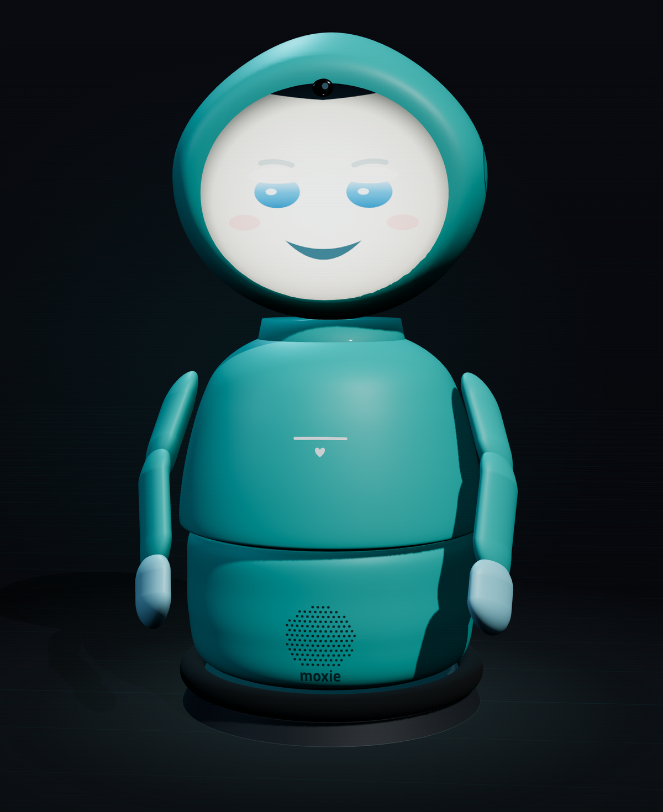

> [HTML view](https://moxie.mattvalancy.com/) · [Markdown index](https://moxie.mattvalancy.com/llms.txt). Generated from the same published source. Interactive controls and 3D scenes are available in the HTML view.

[**Moxie** a ghost in the shell](https://moxie.mattvalancy.com/)

[Docs](https://moxie.mattvalancy.com/docs.html) [GitHub](https://github.com/mvalancy/moxie-robot-saver)

Unofficial · a new brain for Moxie

# Put any AI  
inside Moxie.

[Talk to Moxie](https://moxie.mattvalancy.com/sim) [Revive a robot](https://moxie.mattvalancy.com/setup.html)

Moxie remembers your chat only while her page is open.

Embodied shut down and every Moxie went quiet. But the body — face, voice, gaze, motion — is just a _shell_ that performs whatever brain answers one documented seam. So this is more than a revival: it’s an open kit to put **any AI** inside that shell. Say hi to the 3D Moxie right now — she answers live, in her own voice — then re-home a real robot to a server you control, or read the full reverse-engineering docs, all in your browser.

5

experiences

0

install steps

803

firmware mapped

[

SIM · LIVE    window.moxie · WebGL · runs offline Tap to talk to Moxie](https://moxie.mattvalancy.com/sim)

## Explore

[

### Simulator

A 3D Moxie — face, arms, liveness — that talks and gestures, driven by the same protocol a real robot speaks. No robot, no server needed.

Open the simulator](https://moxie.mattvalancy.com/sim)[

### Revive a robot

Have a real Moxie? Make the two QR codes — Wi-Fi, then your server — and hold them to its camera. Phone-friendly, nothing to install.

Open setup](https://moxie.mattvalancy.com/setup.html)[

### Parent console

An example of the parent dashboard: Daily Missions, rewards, conversation summaries and robot status — the shapes the real cloud used.

Open the console](https://moxie.mattvalancy.com/cloud.html)[

### Docs explorer

Every reverse-engineering doc in the repo, browsable in the page with Mermaid diagrams rendered — how the firmware, protocol and hardware actually work.

Open the docs](https://moxie.mattvalancy.com/docs.html)[

### Source on GitHub

Everything is open. The full toolkit, servers, simulator and reverse-engineering docs — clone it, self-host it, or help map the rest.

View the repo](https://github.com/mvalancy/moxie-robot-saver)

### Bring your own brain

Moxie decides everything it says and does behind one seam — the `RemoteChat` request it sends each turn. Anything that answers it _becomes_ Moxie: a local LLM (Ollama, offline), a cloud model, your own agent. Stand up the backend with `docker compose -f sim/docker-compose.yml up`, wire in a brain, and point the sim _or_ a re-homed robot at it.

[Read the revival guide](https://moxie.mattvalancy.com/docs.html#guides/revive-your-moxie.md)

### Built on the shoulders of OpenMoxie & the community

This revival stands on the work of the people who kept Moxie alive after the shutdown — most of all the **OpenMoxie** project. Go star it, run it, and help push it forward.

[Visit OpenMoxie](https://github.com/jbeghtol/openmoxie)

Created by [Matthew Valancy](https://mattvalancy.com/) with a little ♥ for retired robots.

[moxie-robot-saver](https://github.com/mvalancy/moxie-robot-saver) [mattvalancy.com](https://mattvalancy.com/)

Unofficial fan project — not affiliated with, endorsed by, or connected to Embodied, Inc. “Moxie” is their trademark. This exists so retired robots don’t become landfill.
